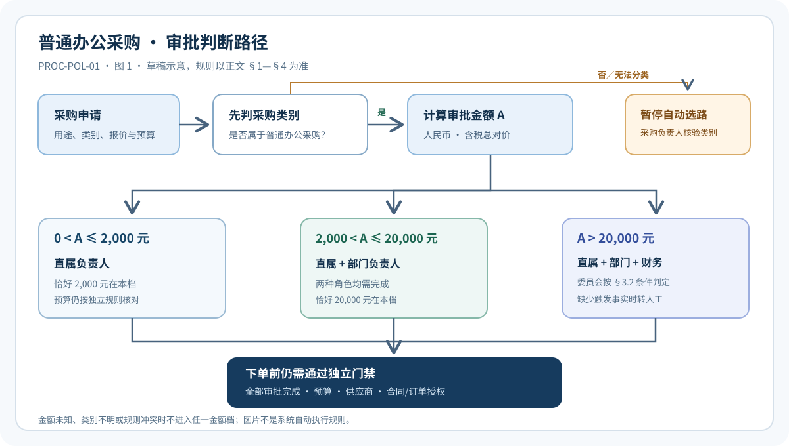

# PROC-POL-01｜普通办公采购审批与金额口径政策

> **虚构企业测试语料｜草稿，未经业务批准，不得用于真实采购或自动审批。** 本文件用于验证检索、引用、时间版本和拒答能力。它不是法律意见、招投标规则或现行公司制度。

## 文档控制

| 字段 | 内容 |
| --- | --- |
| 文档代码 / 版本 | `PROC-POL-01` / `0.2-draft` |
| 文档类型 / 状态 | 采购政策 / `DRAFT`，不可作为已发布知识源 |
| 责任人 / 复核人 | 采购管理负责人（模拟角色，待指派）/ 财务控制与法务负责人（待复核） |
| approvedAt / effectiveFrom / effectiveTo | 未批准 / 未生效 / 不适用 |
| 适用组织 / 人群 | 星河科技及适用子公司提出普通办公采购的员工；见 §1 |
| knowledgeScope / 敏感级别 | `knowledge/procurement` / 内部测试资料 |
| supersedes / 附件 | 无 / 无；正文哈希在正式发布快照中计算 |
| 维护周期 | 拟每年复核，或采购权限、税费口径及组织职责变化时触发修订 |

**权威关系。** 现有[《星河科技员工工作手册》](../../employee-handbook.md)是已经入库的综合测试资料。本文沿用其中普通办公采购的 `2,000/20,000` 元审批边界，拟细化金额与例外口径；本文尚未批准，因此**不覆盖**手册。将来如正式发布，须另有明确的审批、生效和替代公告，不能仅因本文日期较新就使旧资料失效。正式发布也不能改变已在旧版本有效期内形成的历史决策。

## §1 适用范围与不适用范围

### §1.1 普通办公采购

本政策讨论员工为日常办公提出的标准化办公耗材、小型办公设备和公司批准目录内的通用办公服务采购。采购需求属于哪个类别，应由申请中的用途、实际交付物和有效品类目录共同判断，而不是由申请人填写的标题决定。项目成员可以提出申请，但项目负责人不会因此自动取代其正式直属负责人。

### §1.2 需另行分类的事项

个人劳务/用工、生产系统与安全关键软件、处理客户数据的外部服务、跨境履约、关联方交易、合同或专门制度规定特殊程序的事项，不因金额较小就自动成为普通办公采购。这些事项先由采购管理负责人会同对应专业负责人确认类别和适用制度。**无法分类时暂停自动选路**；不得为了匹配本政策而默认改写为“办公用品”。

### §1.3 决策边界

本政策解决“哪些角色必须批准普通办公采购需求”。财务预算、合同授权与签署、供应商准入、收货验收、发票校验及付款各有独立门禁；前一节点通过，不构成后一节点通过。RAG 可以解释本政策，不能直接决定真实流程中的审批人 ID、资金划拨或合同效力。

## §2 金额及采购单元的确定

### §2.1 一项业务需求（R-01）

审批以**一项可识别的业务需求**为单元，而不是以发票张数、付款次数、报价单份数或提交日期为单元。一个需求可对应多个货品或多个供应商订单；同一天向同一供应商采购，也可能有独立需求。判断是否同一需求，应综合用途、使用地点、受益对象、采购决定时间、交付计划和预算来源，并记录关联申请 ID 与判断理由。不能仅凭同型号、同申请人或两天内提交，就自动认定拆单；也不能仅凭供应商不同就认定两项独立需求。

### §2.2 审批金额（R-02）

审批金额是该业务需求在批准时预计由公司承担的**人民币含税总对价**，包含不可选择的配送、安装、实施及服务费用；只扣除报价中已经确定、无需未来条件即可取得的折扣。已付定金只是支付安排，不从审批金额中减除。报价拆成多个发票或由员工垫付，不改变采购需求的总额口径。

按期收费的服务，以拟承诺期限内的总额为基础；未确定期限、数量、价格或必要费用，且无法给出可执行的上限时，金额**不可判定**，应补充报价或封顶条件，不能按最低档审批。独立可选的后续增购，只有尚未承诺且能独立决定时才另案申请；已经一揽子承诺的项目应合并计算。

外币报价应使用申请提交时公司财务发布的适用预算汇率转换，并保存汇率版本和计算过程。若未提供适用汇率或报价日期，先补资料；Agent 不得自行使用实时市场汇率估算审批档位。合同金额或支付币种变化时须依 §4 重新判断。

### §2.3 禁止规避审批的拆分（R-03）

不得为降低审批级别而把同一需求拆成不同申请人、供应商订单、发票或支付批次。发现关联迹象时，先暂停下单并由采购管理负责人核实，记录依据与结论。**关联迹象不是违规结论**：确有独立用途、交付和决定时间的，可分别申请；证据不足时保持待核验，不由模型推测申请人的意图。

## §3 审批路径与角色

### §3.1 金额档位（R-04）

普通办公采购的人民币含税审批金额**大于零且不超过 2,000 元**时，须由直属负责人审批。金额**大于 2,000 元且不超过 20,000 元**时，须由直属负责人和部门负责人共同审批。金额**超过 20,000 元**时，须由直属负责人、部门负责人审批，并由财务中心复核预算；必要时还须采购委员会审议，具体判定按 §3.2。恰好 2,000 元属于第一档，恰好 20,000 元属于第二档。金额为零、负数、关键费用未知或无法换算时，均不能默认进入第一档。

表 1：普通办公采购审批角色对照（金额为人民币含税总对价；表仅辅助比较，规则以 §3.1 文字为准）。

| 金额区间 | 直属负责人 | 部门负责人 | 财务预算复核 | 采购委员会 |
| --- | --- | --- | --- | --- |
| `0 < A ≤ 2,000` 元 | 必需 | 不因本政策必需 | 按财务独立规则 | 不因本政策必需 |
| `2,000 < A ≤ 20,000` 元 | 必需 | 必需 | 按财务独立规则 | 不因本政策必需 |
| `A > 20,000` 元 | 必需 | 必需 | 必需 | 满足 §3.2 条件时必需；其余由采购负责人书面判断 |

上表“按财务独立规则”不表示财务对小额采购必然不参与；它只说明**本政策的金额分档没有额外规定该复核**。预算不足仍不能下单。两种审批角色若落在同一自然人身上，是否允许兼任应依已批准的职责分离矩阵判断；缺少矩阵时转人工，不能自动合并为一次点击。

图 1：普通办公采购的分类、金额分档与下单前门禁（草稿示意；图中条件均以本节和 §1—§4 的文字规则为准）。

**图 1 的完整文字说明。** 入口是采购申请。先按 §1 判断是否属于普通办公采购；不属于或无法分类时停止自动选路，由采购负责人核验，不能进入任一金额分支。属于普通办公采购时，按 §2 计算人民币含税总对价 `A`；金额未知、为零或负数、费用缺项或无法换算时先补资料。`0 < A ≤ 2,000` 元进入直属负责人审批；`2,000 < A ≤ 20,000` 元进入直属和部门负责人共同审批；`A > 20,000` 元进入直属和部门负责人审批、财务预算复核，并按 §3.2 核验是否需要采购委员会。任何必需节点未完成、被驳回或失效，均不应进入下单门禁。三条金额路径最后汇入同一个门禁：全部必需审批、预算、供应商准入、合同/订单授权均须核对；门禁通过才允许有权角色下单。图中没有描绘实际付款或报销，因为二者不是采购审批的自动后继状态。

### §3.2 大额委员会判定（R-05，拟议细化）

手册使用“必要时由采购委员会审批”，未枚举必要情形。为后续评测提供可判定规则，本**草稿拟议**：金额超过 20,000 元，且存在以下任一情况，应提交委员会：唯一供应来源且缺少独立理由、拟选供应商未完成准入、与关联方交易、涉及跨境履约或客户敏感数据处理；预算不足或拟超预算的申请亦须先由财务处理预算缺口，再由采购负责人决定是否提交委员会。委员会同意**不能**代替预算落实、供应商准入、合同授权或法定程序。

若上述事实均已查明且不触发，采购负责人应记录“不提交委员会”的理由；其仍可因其他重大供应或声誉风险书面提交。若供应商准入、关联关系或数据处理情况未知，结论为“待核验”，不能把空值当作“不触发”。**在 R-05 获正式批准前，不得让 Agent 将这些拟议条件作为现行政策自动执行。**

### §3.3 角色解析与任务汇聚（R-06）

政策只规定角色，具体直属负责人、部门负责人和委员会成员由可信组织数据、授权矩阵及流程派单规则解析并在任务激活时冻结。并行审批时，只能在所有必需任务完成且无驳回、撤回或失效后，才形成该档位的业务审批通过。项目负责人、临时代理人、预算负责人均不能仅凭头衔替代应到的角色；有效授权及期限必须单独核验。

## §4 下单门禁、变更和例外

### §4.1 “通过审批”不等于“可下单”（R-07）

申请已提交、报价已上传、预算有余额、某位审批人同意，均不能证明采购审批完成。所有必需审批完成后，还需核对报价有效期、预算来源、供应商准入和合同/订单签署权限，方可由有权角色向供应商发出有约束力的订单。收货验收与付款/报销在下单后各自办理，不因采购审批成功自动完成。

### §4.2 金额或范围变化（R-08）

批准后，若采购对象、数量、强制服务费用、币种或含税总额变化，申请人应在新增承诺前更新申请并保存旧版本。**跨越档位**时，须补齐新档位的审批与复核；虽未跨档但超出原批准报价/范围时，须由采购负责人判断是否重审并记录依据。金额降低不删除原审批审计，也不自动证明交付无差异。不得事后用拆开发票、调换品名或修改支付批次使总额“看起来”落回旧档。

### §4.3 紧急事项（R-09）

申请人必须说明延迟采购的具体影响、替代方案为何不可行和期望决策时间。紧急路径可在**获得有权角色明确授权**后调整审批顺序，但不得默许跳过预算、合同、信息安全或留痕要求，也不存在默认的“先买后补单”豁免。尚未发布的[`PROC-SOP-01`](PROC-SOP-01.md)不能提供可执行的紧急时限；缺少已批准的紧急权限或代理规则时应转人工，不由 Agent 编造时限。

## §5 时间版本、证据不足与裁决

### §5.1 适用时间（R-10）

审批决定应使用**决定作出时**有效、且适用于该组织与采购类别的制度版本；如果制度在审批后、对外形成采购承诺前发生变化，须按过渡公告判断是否重审，不能当然沿用旧批准，也不能当然追溯推翻旧决定。提交日、审批日和合同承诺日不同时，须分别记录时间与依据版本。本文尚未生效，只能用于草稿审查和测试，不得替代当前已入库手册。未来变更阈值、品类或金额口径必须发布新版本并记录 `supersedes`、生效区间和过渡安排，不得覆盖旧文件。

### §5.2 无法自动判断的情形（R-11）

缺少类别、费用明细、适用汇率、供应商准入状态、预算归属、有效组织关系或制度生效日期时，系统应指出缺失字段并保持待补充/人工复核。若同级已批准政策相互冲突，保留双方引用并交政策所有者裁决，不按更新时间或检索分数选择。如果查询“这笔申请能否下单”，但仅有政策文档、没有实时申请和审批状态，则只能解释门禁，不能断言该笔交易已获批准。

## §6 解释性案例（合成数据，不创设例外）

表 2：六个合成案例用于检验金额口径、拆单与证据不足的边界；结论均可由前述文字规则独立推出。

| 案例 | 应引用的规则 | 解释 |
| --- | --- | --- |
| 含税办公耗材恰好 2,000 元 | R-02、R-04 | 属第一档；仍需直属负责人审批。 |
| 货品 19,700 元，必付配送安装费 500 元 | R-02、R-04 | 总额 20,200 元，属于第三档。 |
| 两天各报 1,500 元同型号设备，均用于同一会议室 | R-01、R-03 | 有合并核验迹象，但不能仅凭型号和时间自动定性违规。 |
| 18,000 元获批后，配置增加使总额变成 21,000 元 | R-08、R-04 | 新增承诺前补齐第三档审批和预算复核。 |
| 部门预算余额 30,000 元，采购申请尚未提交 | R-07 | 预算余额不证明采购已批准，不能直接下单。 |
| 25,000 元申请，供应商准入和预算归属均未知 | R-05、R-11 | 不能判定委员会/预算结果，应先补资料。 |

正式 FAQ 将提供更多反例与跨域证据，不反向修改本政策。

## §7 图表、依赖与发布门禁

本政策使用表 1 帮助核对阈值，并使用图 1 让分类、金额分支和汇聚门禁一眼可见。两张表和图 1 都有邻近的独立文字说明；**当前 Markdown 摄取只保证正文文本，不解析图片像素，也不保证表格行列结构**。因此检索答案应引用 R-01 至 R-11 的文字规则，不以孤立表格行或图片链接作为唯一证据。图中若与正文出现冲突，以经审批的文字规则为准，并将图文不一致作为文档质量问题阻止发布。

表 3：图 1 的资产清单。本表记录仓库草稿资产；正式发布时必须将图片和正文打包成同一 `DocumentVersion`，重新核验哈希。

| assetId | 相对路径 | MIME / 版本 | 来源与权限 | SHA-256 |
| --- | --- | --- | --- | --- |
| `PROC-POL-01-FIG-01` | `assets/PROC-POL-01/PROC-POL-01-FIG-01.svg` | `image/svg+xml` / `0.1-draft` | 本项目原创示意图；与正文同属 `knowledge/procurement` 内部测试资料 | `06d3ae1be23d1157659535a697563d0eb93cbf7967ef6625c0ab046c292e7658` |

图 1 禁止外部热链和嵌入脚本；正式发布前应按[知识文档编写与多模态扩展规范](../../../../architecture/rag-document-authoring-standard.md)验证资产存在、哈希一致、替代文本、长说明、尺寸和访问范围。现有单文件上传不会自动打包该 SVG；若只上传 Markdown，图 1 会缺失，必须在导入前给出明确提示，不能标记为图文完整摄取。

本政策不覆盖采购操作规程的表单与状态、财务制度的支付/入账、法务的合同授权，亦不作法定招采结论。正式发布至少需采购负责人审定需求单元、金额和委员会条件，财务负责人确认预算与汇率口径，法务负责人确认特殊品类和授权边界；再填写具名审批者、实际生效时间和版本替代关系，经引用、权限和临界值回归测试后发布。未完成前保持 `DRAFT`，不进入真实审批 Agent 的默认知识范围。
